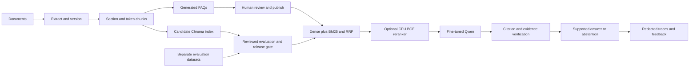

# AI platform operations and deployment

## Architecture and rollout

Keep the existing fine-tuned Ollama registration `shopassist-finetuned`. The
actual mitao server reports **1.5B Q4_K_M**, digest
`51e0493f09f1f69b0b3d92b00596cd1fd9aa3ef5db8736d38349e81a6ee3af6b`.
The request's 3B fine-tuned model is not present; do not substitute an unfine-tuned
3B model. FAQ generation now defaults to the existing `shopassist-finetuned`
registration, as requested. Independent verification uses `qwen2.5:1.5b`; both
models remain configurable without replacing the answer model.



`SHOPASSIST_PIPELINE=legacy` is an explicit compatibility rollout mode for an
existing deployed index. Keep it while the grounded pipeline is staged. It does
not pass upgraded verification and cannot authorize a grounded release. After
review and passing evaluation, switch to `grounded` and use `scripts/serve.py`.

Both live-compatible and grounded chat entry points now route every query before
retrieval. Exact greetings/thanks/farewells/general help messages use fixed
non-policy replies without a model or vector search. Other messages pass a
schema-constrained, history-aware intent filter: only KNOWLEDGE proceeds to
document retrieval. CONVERSATION, CLARIFICATION, ACCOUNT_ACTION and OUT_OF_SCOPE
return source-free replies. An unavailable intent filter abstains instead of
searching blindly. A greeting prefix never suppresses an actual policy question;
contextual follow-ups still use the recent conversation.

The historical A/B baseline retains its original scope filter by default. The
deployed legacy wrapper supplies the new intent decision so it does not run two
classification calls. Its policy-answer generation remains the legacy path.

Reviewed, published FAQ questions now appear as suggestion buttons in the existing
chat sidebar. Clicking one sends the question through the normal conversation and
retrieval pipeline. Approved/published question variants also improve BM25 recall in
the grounded retriever by resolving back to the official source chunk. The answer
is generated and checked against that source, rather than blindly copying an FAQ.
Drafts/rejected/outdated FAQs are excluded. The currently deployed legacy answer
path uses policy retrieval for the selected question rather than copying the FAQ
answer. The 54 benchmark drafts are evaluation examples,
not published production FAQs, and cannot automatically become customer knowledge.

## Install and initialize

Use Python 3.11 as in the original README, with a separate virtual environment.
Install `requirements.txt`, or `requirements-ocr.txt` for PDF tables/OCR. OCR also
requires the local Tesseract executable. The Docker image includes Tesseract;
Docker build and ARM deployment still require execution on the target host.

Settings use `SHOPASSIST_` environment variables; see `.env.example`. The app does
not automatically load `.env`. Never commit passwords, role hashes, OIDC secrets,
weights, live indexes or conversation traces. Disable model downloads after
provisioning. Pin embedding artifacts with `SHOPASSIST_EMBEDDING_REVISION=hf:<commit>`
for a reproducible production embedding identity.

```sh
python -m src.admin hash-password
python -m src.admin --help
```

Set the resulting hash in `SHOPASSIST_ADMIN_PASSWORD_HASH`; use separate reviewer
and evaluator hashes for their roles. Admin operations prompt for the password
without echo. Role passwords are not customer credentials. Local filesystem
owners can always execute Python directly; protect the server account and state
directory. Hosted customer login uses Streamlit OIDC with
`SHOPASSIST_REQUIRE_LOGIN=true` and provider configuration in an untracked
`.streamlit/secrets.toml`. The existing public deployment can retain its current
access policy during compatibility rollout. Terminate HTTPS at the existing proxy.

## Ingestion and FAQs

```sh
python -m src.admin ingest data/policies/shipping.pdf --extract-only
python -m src.admin ingest data/policies/shipping.pdf --enqueue
python -m src.admin worker --once
python -m src.admin status
python -m src.admin rebuild-index
python -m src.admin generate-faq CHUNK_ID --count 5
python -m src.admin list-faqs
python -m src.admin --role reviewer edit-faq FAQ_ID changes.json
python -m src.admin --role reviewer faq-transition FAQ_ID APPROVED
python -m src.admin faq-transition FAQ_ID PUBLISHED
```

Replace IDs with those from status/list output. The compatibility command
`python src/ingest.py` stages every supported policy file; it never clears the old
collection. Extraction-only staging uses a conservative UTF-8 byte-token budget;
indexing/rebuild rechunks with the actual embedding tokenizer. Window pooling
embeds every token window, avoiding MiniLM prefix truncation. Index identities
include model, revision, pooling and chunk settings. No incompatible dimensions
share a collection. PDF page numbers are one-based; DOCX/TXT pages are null.

FAQ imports require explicit published/verified fields. Evaluation JSON/CSV is
rejected by production ingestion. Generated FAQ IDs, source versions, exact
evidence and generation history are controlled by the service. Edits return an
FAQ to review, document updates/deletion make old FAQs OUTDATED, and publishing
requires a human approval on the active source version. No feedback is training
data. Use `feedback-correction` with a supplied candidate JSON to propose a
verified correction, then review and publish it separately.

Jobs use leases, heartbeat renewal, idempotency keys and bounded retry backoff.
After a worker crash during ingestion, stop the worker, inspect status, run
`recover-ingestion VERSION_ID`, then retry the original job. Automatic retries
never discard the active source version. Do not run multiple unrelated workers
against different copies of the same control database.

### FAQ worker and the existing legacy deployment

`python -m src.worker --check` verifies the configured FAQ/verifier model digests;
`python -m src.worker --once` executes one queued job without a password prompt.
The worker uses the operating-system service account with an ingestion-only role:
it cannot approve FAQs, publish them, manage tickets or activate an index. Install
`deploy/ai-platform/shopassist-worker.service` for continuous processing and load
the same protected `deploy/ai-platform/runtime.env` in the app service. Queued jobs
and their status appear in the administrator's FAQ workspace.

For the existing legacy collection, an administrator can run
`python -m src.admin adopt-legacy-sources`. This checks every existing indexed PDF
excerpt against the current source page and requires at least 80% coverage of each
nonempty page before recording source versions. It never modifies vectors or
publishes an FAQ. It refuses to run with an active upgraded index. This allows
human-approved FAQ suggestions against the already served sources while the
grounded index remains gated. If source matching fails, review/reindex separately.

### Human support tickets

Explicit human requests create session-owned tickets immediately. Other unresolved
support requests first receive targeted follow-up questions or supported guidance.
The default budget is three customer-facing support cycles; set
`SHOPASSIST_SUPPORT_MAX_ATTEMPTS=2` for two. Internal model retries are separate.
The bot uses detail replies before deciding failure, checks the outcome, and
queues human support once the issue remains unresolved at the budget. Greetings,
thanks, unrelated questions and blocked instructions do not consume attempts.
Repeated handoffs reuse the owned open ticket. Each issue has its own dedupe key
and summary, so a generic reply such as "No" does not merge unrelated issues.
See [resolution flow and migration](RESOLUTION_FLOW.md).

Creating tickets does not send email or invoke an external help desk. A human
team must monitor the queue. No CRM or transaction capability is added.

Customers can use **Talk to a human**, see status and replies under **Your support
tickets**, and add details. These controls use the current Streamlit session;
reopening the site in a new browser session does not restore previous tickets.
Support staff use **Staff workspace** with the `support` role. Reviewers and
evaluators cannot access customer tickets. Staff can assign, reply and resolve;
resolved/closed tickets accept no further replies or reopening.

Set `SHOPASSIST_SUPPORT_PASSWORD_HASH` with the same hidden-password hashing command
used for other roles. Administrator/reviewer credentials govern FAQ operations.
Keep runtime configuration and any provisioned credential file readable only by
the service account. Never put either in Git.

Questions, history and ticket messages are redacted before storage. Optional
follow-up email/phone collection is available only when
`SHOPASSIST_TICKET_ENCRYPTION_KEY` contains a persistent Fernet key. Generate one
with `python -c "from cryptography.fernet import Fernet; print(Fernet.generate_key().decode())"`
in a private terminal and preserve it between releases. Contact details are
encrypted at rest and access by authorized staff is audited.

The CLI also provides `--role support tickets`, `ticket-detail REFERENCE`,
`ticket-update REFERENCE STATUS --assignee NAME`, `ticket-reply REFERENCE reply.txt`
and `prune-tickets`. Pruning removes only resolved/closed tickets older than
`SHOPASSIST_TICKET_RETENTION_DAYS` (default 90); run it as a scheduled staff/admin
maintenance task. Traces may expire independently without deleting open tickets.

## Datasets and evaluation

```sh
python -m src.admin seed-benchmark --index-id CANDIDATE_INDEX_ID
python -m src.admin dataset-export DATASET_VERSION review.json
python -m src.admin --role reviewer dataset-review DATASET_VERSION CASE_ID_1 CASE_ID_2
python -m src.admin evaluate REVIEWED_VERSION --variant all --judge both --index-id CANDIDATE_INDEX_ID
python -m src.admin compare BASELINE_REPORT.json CANDIDATE_REPORT.json
python -m src.admin activate-index CANDIDATE_INDEX_ID CANDIDATE_REPORT.json --baseline-report BASELINE_REPORT.json
```

Review each question, expected answer, answerability, source IDs and exact source
evidence. Imported claims of prior review are reset. Splits group paraphrases,
shared ground truth and multi-document component facts, using a fixed seed. Each
review creates a new immutable dataset version. Evaluation questions never write
production chunks. The seed has 54 candidates across all six requested categories;
expand only from supported knowledge toward the 300-case distribution. The current
draft held-out subset is too small for the minimum 30-case release gate.

Install optional `requirements-eval.txt` for Ragas/DeepEval. Both adapters explicitly
use local Ollama; missing dependencies/models are errors, not cloud fallbacks.
These library-dependent integrations require a live compatibility check. Run
development and validation experiments before using the held-out test set. A–E
variants share identical dataset version/case IDs. A retains the old pipeline and
requires its existing collection. Missing semantic measurements remain null.

Recall@1/3/5 and MRR use ranked candidates; context precision/recall use the actual
selected context. Source-evidence anchors permit comparisons across chunking/index
versions. Exact string match is separate from semantic correctness. Citation-ID
validity is separate from citation entailment. Python allocation peaks are not
host RAM/VRAM usage. Product latency excludes offline judge calls.

Reports contain configuration, prompt/model versions, actual Ollama digest,
timestamp, failures and JSON/CSV rows. Signatures bind them to this installation;
corpus changes invalidate activation. All eight requested targets, human-reviewed
held-out data, no execution errors, sufficient cases and the verified E variant
are required. Index replacements also require a signed baseline, no serious
metric/error/latency regression and measurable retrieval improvement.

```sh
python -m src.admin retrieval-grid REVIEWED_VERSION --models sentence-transformers/all-MiniLM-L6-v2 BAAI/bge-m3
python -m src.admin retrieval-grid REVIEWED_VERSION --rerank
python -m src.admin chunk-benchmark data/policies/shipping.pdf
```

The grid compares 400/500/700 embedding-token budgets in separate candidate
collections; it never activates them. `chunk-benchmark` is structure/timing only,
using conservative byte tokens, and is not a retrieval-quality claim. Local free
RAM was about 0.8 GiB, so BGE was not loaded there. Benchmark on suitable hardware.
The mitao server has about 11 GiB RAM and 10 GiB available at inspection.

Confidence is null until empirical calibration is fitted to human-reviewed
development outcomes with `calibrate`. Never fit on held-out data. Calibration
is invalidated by index/model changes; model self-confidence is never used.

## Monitoring, security and deployment

`monitor`, `feedback`, `prune-traces`, `backup` and `rollback-index` are authenticated
CLI operations. Traces include query IDs, retrieval/reranker scores, answer,
verification, versions, timings and escalation. Emails, phone-like numbers,
account/order identifiers and credential patterns are redacted. Regex redaction
does not recognize every name/address; restrict access, review PII handling for
your deployment and retain no longer than necessary. Traces expire after 30 days
and are capped at 10,000 by default. Feedback ownership is checked against the
current session. Configure edge rate limiting too; application limits are per
session. No third-party tracing or prompt export is configured.

The new Docker/Compose path runs without root, with read-only root storage,
bounded memory/CPU/processes, loopback publishing and persistent state/cache
volumes. Configure secrets/OIDC and an HTTPS proxy before hosting. The production
entry point refuses startup without the validated index/report/model digest.
The existing systemd server can receive source updates in compatibility mode,
with its original model and Chroma directory retained. Do not point it at a new
empty collection and remove the working service during staging.

Quiesce app/workers before `backup NEW_DIRECTORY` to coordinate SQLite, document
blobs and Chroma. Copy the backup outside the host and encrypt it. Restore into a
new directory, verify hashes and ownership, set state/vector paths, run checks,
then switch the service. `rollback-index` restores the previous index and document
pointers; deleted documents stay deleted and FAQs do not automatically republish.
For code rollback, restore the deployment checkpoint and its systemd drop-in,
restart the service, then check `/_stcore/health` and a real policy question.

## Primary API references

- [Ollama structured outputs](https://docs.ollama.com/capabilities/structured-outputs)
- [Ollama model identities](https://docs.ollama.com/api/tags)
- [Chroma collection configuration](https://docs.trychroma.com/docs/collections/configure)
- [Ragas evaluate](https://docs.ragas.io/en/stable/references/evaluate/)
- [DeepEval faithfulness](https://deepeval.com/docs/metrics-faithfulness)
- [Streamlit OIDC login](https://docs.streamlit.io/develop/api-reference/user/st.login)
- [BGE-M3](https://huggingface.co/BAAI/bge-m3), [BGE reranker](https://huggingface.co/BAAI/bge-reranker-base)
